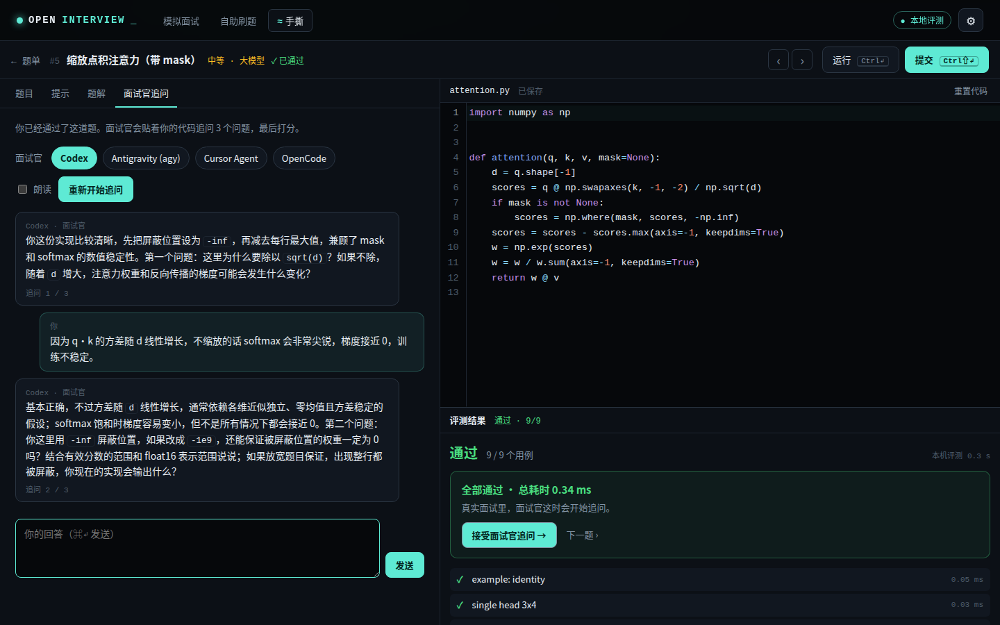
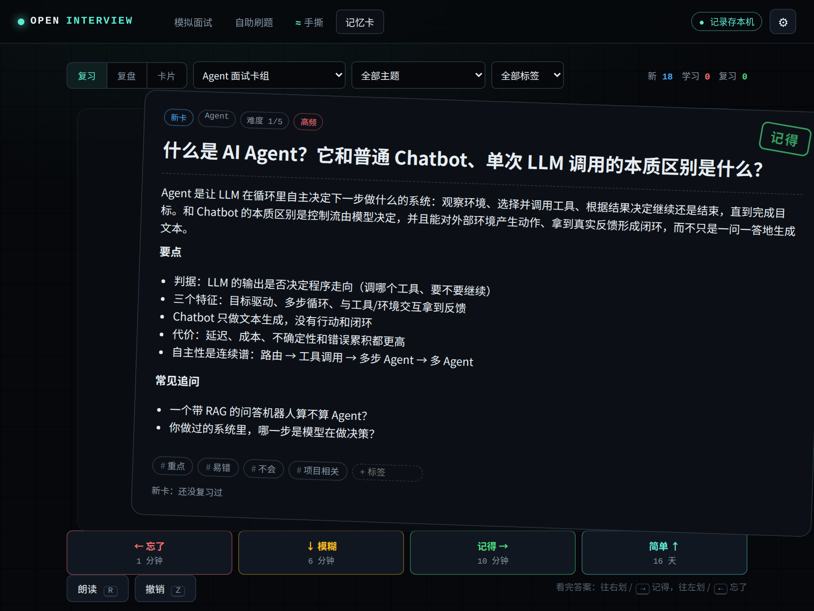

<div align="center">

# Open Interview

**Open interview question bank + mock interviewer + free voice interviews**

Draws real, sourced questions from a bank of 4,000+ by **company / role / round / topic**, and lets the AI agent
already on your machine (Claude Code, Codex, Antigravity, Cursor, OpenCode) be the interviewer: one question at a
time, follow-ups, then a scored report. Questions are read aloud and you answer out loud.

[中文](README.md) · **English**

[Web interview](#option-1-web-interview-recommended) · [Inside your agent](#option-2-inside-your-agent) · [allclose · 手撕](#allclose--手撕-ml--llm-coding-judged-locally) · [Flashcards](#flashcards-agent-interview-deck--spaced-repetition) · [Practice online](https://bigerbigernerd.github.io/open-interview/) · [Question bank](#question-bank) · [Contribute](CONTRIBUTING.md)

</div>

---

## Why

- Interview reports (面经) are scattered across dozens of repos and posts in different formats that agents can't use.
- Most "mock interview prompts" let the model invent questions, with no real company or round context.
- This project normalises open-source questions into one **tagged, sourced** format that anyone can extend by pull
  request. The interviewer runs on the agent you are already logged in to: no API key, no extra cost.

## Five ways to use it

| | For | Start with |
|---|---|---|
| **Web interview** (recommended) | Open a page and start | `python3 skills/mock-interviewer/scripts/studio.py` |
| **Inside your agent** | You already live in Claude Code / Codex | Install the skill, say "mock interview me by voice" |
| **Practice online** | Nothing to install, just drill questions | [GitHub Pages](https://bigerbigernerd.github.io/open-interview/) |
| **allclose · 手撕** | Hand-coding rounds for LLM / ML roles | The 手撕 tab in the web app, or `skills/allclose/scripts/allclose.py` |
| **Flashcards (记忆卡)** | Memorizing the concepts, prepping for AI Agent roles | The 记忆卡 tab: swipe cards like Anki |

## Option 1: web interview (recommended)


```bash
git clone https://github.com/bigerbigernerd/open-interview
python3 open-interview/skills/mock-interviewer/scripts/studio.py
```

A browser tab opens. Pick an interviewer backend, then company, role, level, round, language and number of
questions, and press start. Everything happens in the page: questions are spoken, you answer by voice (or typing),
ask for a hint, skip, or end at any time, and get a report at the end.

The page detects which agent CLIs are installed and calls one per turn (headless, no tools, in an empty directory):

| Backend | Command | Measured per turn |
|---|---|---|
| Codex | `codex exec` (read-only sandbox, low reasoning effort) | ~10-15 s |
| Antigravity | `agy -p` | ~15 s |
| Cursor Agent | `cursor-agent -p --mode ask` | ~15-20 s |
| OpenCode | `opencode run --agent plan` | ~10 s |
| Claude Code | `claude -p --tools ""` | adapter written, not yet run on the author's machine |

Log in to the CLI in a terminal first. Use the model field to pick a model (e.g. `gpt-5`, `sonnet`,
`opencode/big-pickle`). If a CLI lives somewhere unusual, point to it with an environment variable such as
`OPEN_INTERVIEW_CODEX_BIN=/path/to/codex`.

Check which backends work:

```bash
python3 skills/mock-interviewer/scripts/backends.py list
python3 skills/mock-interviewer/scripts/backends.py ping codex
```

## Option 2: inside your agent

**Claude Code**

```bash
/plugin marketplace add bigerbigernerd/open-interview
/plugin install open-interview@open-interview
```

**Codex / Cursor / Gemini CLI / OpenCode and other Agent Skills tools**

```bash
npx skills add bigerbigernerd/open-interview
```

Or copy `skills/mock-interviewer/` into your agent's skills folder (e.g. `~/.claude/skills/`). The skill only needs
the Python 3 standard library. Then ask:

```text
Mock interview me for a Google SWE phone screen, by voice, in English
Give me 5 LLM / RAG questions, difficulty 3+, and score me at the end
```

For voice interviews the agent starts a local bridge and gives you a link:


```text
┌──────────────┐  voice.py ask "…"   ┌───────────────┐   long-poll   ┌──────────────────────┐
│  your agent  │ ──────────────────▶ │ local bridge  │ ◀───────────▶ │ browser tab          │
│ (the brains) │ ◀────────────────── │ 127.0.0.1:8765│               │ speaks + transcribes │
└──────────────┘   your answer text   └───────────────┘               └──────────────────────┘
```

`voice.py ask` waits at most 50 seconds; if you are still talking it exits with code 3 and the agent loops on
`voice.py wait`, so it never runs into an agent's command timeout. Codex's default sandbox blocks local network
access; allow it the first time it runs.

## About the voice

- Speech uses the browser's built-in `speechSynthesis`, which is free. Edge's *Microsoft … Online (Natural)* and
  Chrome's *Google* voices sound best; change voice and speed under ⚙ in the top-right corner.
- Transcription uses the Web Speech API (`SpeechRecognition`) in Chrome, Edge and Safari. Firefox lacks it; type instead.
- Privacy: the server only listens on localhost, but Chrome and Edge send audio to Google / Microsoft cloud speech
  services. If that bothers you, type your answers.
- Transcripts are saved to `~/.mock-interviewer/sessions/` and can be exported as Markdown from the page.

## Self practice

The "自助刷题" tab needs no agent: filter by role, company, type and language, hear the question, answer by voice
or typing, and reveal key points and the source. Export your practice log as Markdown and paste it into any AI
for grading.


- Locally: the page opened by `studio.py` or `voice.py start`
- Online: enable GitHub Pages (Source: GitHub Actions) and it deploys to `https://bigerbigernerd.github.io/open-interview/`

## allclose · 手撕: ML / LLM coding, judged locally



LeetCode for ML and LLM interviews ("手撕" is the Chinese interview term for coding something by hand). Write
attention, RoPE, a KV-cache step, top-p, BPE, DPO, GRPO… in numpy in the browser editor and press Submit. Your
code runs in a separate Python process **on your own machine** and is compared with a reference on every case;
it passes when it is within `rtol 1e-5 / atol 1e-6`, i.e. `np.allclose`. Nothing is uploaded and there is no online judge.

- **Tests aimed at the usual bugs**: overflow on large values, masking in the wrong place, splitting heads
  without a transpose, RoPE pairing, the token that crosses top-p, biased vs unbiased BatchNorm variance, tied
  AUC scores… Every problem ships buggy variants, and CI checks that the tests catch all of them.
- **Failures say exactly what is wrong**: the case, the position, expected value, your output, max error, and whatever you `print`.
- **Follow-up questions once you pass**: in a real interview the code is only the start. The Claude Code / Codex /
  agy / Cursor / OpenCode CLI on your machine plays the interviewer, asks three questions about your code (why
  divide by √d? what if -inf becomes -1e9?) and scores you. When stuck, it can look at your code and give a hint.
- **One file for the web and the CLI**: your code lives in `~/allclose/<problem>.py`; edit it in VS Code, submit it from the page, or the other way round.

| Track | Problems | |
|---|---|---|
| LLM | 18 | Attention with masking · Multi-head attention · RoPE · Temperature + top-k + top-p sampling · GQA · One decoding step with a KV cache · SwiGLU · LoRA · Beam search · Byte-level BPE training · MoE routing + load-balancing loss · DPO · PPO clipped objective · GRPO · Merging partial attention results (the core of FlashAttention) · CLIP contrastive loss · int8 quantization · Speculative decoding verification |
| Deep learning | 8 | Stable softmax · Cross-entropy with label smoothing · LayerNorm · RMSNorm · BatchNorm with running stats · AdamW · MLP backprop by hand · conv2d |
| ML basics | 4 | ROC AUC · Logistic regression · K-means · IoU + NMS |

10 easy, 14 medium, 6 hard; statements in Chinese and English.

```bash
# Web: same server as the mock interview, then open the 手撕 tab
python3 open-interview/skills/mock-interviewer/scripts/studio.py

# CLI
cd open-interview/skills/allclose
python3 scripts/allclose.py --lang en list    # ✓ = passed
python3 scripts/allclose.py pull attention    # creates ~/allclose/attention.py; use any editor
python3 scripts/allclose.py test attention    # all cases; --run for the samples only
python3 scripts/allclose.py --lang en hint attention
```

Judging needs numpy: the current Python if it has numpy, otherwise `uv run --with numpy` when
[uv](https://docs.astral.sh/uv/) is installed, otherwise `pip install numpy`. The online page (GitHub Pages)
shows the problems and keeps drafts, but judging and follow-ups run locally.

Inside Claude Code / Codex: install the `allclose` skill and ask for "an LLM coding problem"; the agent sets one,
judges your file locally and asks follow-ups once it passes. The problem format is in [skills/allclose/SKILL.md](skills/allclose/SKILL.md).

## Flashcards: Agent interview deck + spaced repetition



Anki-style review for interview concepts: answer in your head, tap the card to see the answer, then **swipe right
if you remembered it, left if you didn't** (keys `→` / `←`, `↑` easy, `↓` hard, `Z` undo). The next review is
scheduled by [FSRS](https://github.com/open-spaced-repetition/fsrs4anki), the scheduler Anki now uses by default.

- **Agent interview deck (315 cards with reference answers, in Chinese)**: agent basics and planning, tool use and MCP,
  memory and context engineering, multi-agent and frameworks, evaluation / safety / production, RAG, agent training and
  LLM basics, and system design / project deep-dives / coding. Each card's back has the 30-second answer, the key points
  and common follow-ups. You can also review all 500+ AI-agent questions in the bank (most without answers) or the whole bank.
- **Review dashboard**: average recall probability right now, true retention over 30 days, your forgetting curve
  (FSRS prediction vs what actually happened), daily reviews and retention, the 14-day due forecast, weak spots by
  tag and topic, and the cards you forget most, each with one-click extra practice.
- **Tags**: mark cards 重点 / 易错 / 不会 / 项目相关 or your own tags; filter and review by tag.
- **Export for an AI review**: weak topics and most-forgotten cards, with reference answers, as Markdown.
- **Where the data lives**: with `studio.py`, in `~/.mock-interviewer/cards/reviews.jsonl` (one line per review; all
  state is replayed from it). On GitHub Pages, in the browser, with JSON export / import.
- **Local extra decks**: drop a `cards-extra.json` into `skills/mock-interviewer/data/` (git-ignored) and the flashcards
  merge its questions in, adding 面经 / hot / per-area / per-course decks; course decks introduce new cards in lecture
  order. `$math$` in questions and answers renders with KaTeX. The format is in `mergeExtra` in `ui/cards.js`.

## Question bank

**5,481** questions: 5,166 (893 of them from 60 interview reports) from 18 permissively licensed open-source projects, each with a link back to its source, plus the 315 answered cards of the Agent interview deck above. Question sources:

| Source | Questions | Area | License |
|---|---:|---|---|
| [haizlin/fe-interview](https://github.com/haizlin/fe-interview) | 2,789 | Front end (Chinese, lower sampling weight) | MIT |
| [Snailclimb/JavaGuide](https://github.com/Snailclimb/JavaGuide) | 721 | Java back end, CS fundamentals, AI apps | Apache-2.0 |
| [SuperGODOG/ai-agent-interview-240](https://github.com/SuperGODOG/ai-agent-interview-240) | 235 | AI agent engineering, LLMs | MIT |
| [h5bp/Front-end-Developer-Interview-Questions](https://github.com/h5bp/Front-end-Developer-Interview-Questions) | 145 | Front end (English) | MIT |
| [kdn251/interviews](https://github.com/kdn251/interviews) | 129 | Coding, tagged by company | MIT |
| [yangshun/tech-interview-handbook](https://github.com/yangshun/tech-interview-handbook) | 117 | Behavioral, tagged by company | MIT |
| [MisterBooo/llm-interview-questions](https://github.com/MisterBooo/llm-interview-questions) | 100 | LLM / RAG / agents | CC BY-SA 4.0 |
| [donnemartin/system-design-primer](https://github.com/donnemartin/system-design-primer) | 37 | System design | CC BY 4.0 |

Tags on every question:

| Field | Example | Notes |
|---|---|---|
| `companies` | `bytedance`, `google` | Only where the question was actually asked; aliases work (字节, tiktok) |
| `roles` | `backend`, `frontend`, `ai-agent`, `llm-algorithm` | Hierarchical: `backend` also matches general `swe` questions |
| `type` | `technical` `coding` `system-design` `behavioral` `project` `hr` | |
| `topics` | `redis`, `rag`, `react` | Open vocabulary |
| `levels` / `difficulty` / `hot` | `campus`, `3`, `true` | Hiring track, 1-5, high frequency |

Interview reports (面经, one real interview with its rounds) live in `bank/experiences/`; the interviewer mirrors
their round structure when one exists. There are **60** so far (893 questions; 44 in Chinese, 16 in English): the upstream authors' own
interviews from 10 MIT-licensed repos, covering ByteDance, Alibaba, Tencent, Baidu, Huawei, Ant Group, Infosys,
Deloitte and more. Company, rounds, date and result are only filled in where the author stated them. Sources are
listed in [LICENSE-DATA.md](LICENSE-DATA.md). Template: [`bank/experiences/_template.yml`](bank/experiences/_template.yml).

Query from the command line:

```bash
cd skills/mock-interviewer
python3 scripts/bank.py stats
python3 scripts/bank.py sample --company bytedance --role backend --mix technical=3,coding=1,behavioral=1
python3 scripts/bank.py search --role ai-agent --topic rag --difficulty 3-5
python3 scripts/bank.py show <id> -v
```

## Repository layout

```text
bank/
  tags.yml                  controlled tags: companies (with aliases), roles (with parents), types, levels, topics
  questions/                questions; imported/ is generated from upstream, do not edit by hand
  experiences/              interview reports, one file per interview
skills/allclose/            allclose · 手撕 (installable on its own)
  problems/<id>/            one folder per problem: statement, starter, reference, tests, buggy variants
  scripts/allclose.py       CLI + judge (stdlib only)
  scripts/runner.py         runs your code in a separate process (needs numpy)
  data/problems.json        generated by tools/build.py
skills/mock-interviewer/    the installable skill
  SKILL.md                  interviewer workflow
  scripts/bank.py           question queries (stdlib only)
  scripts/voice.py          voice bridge for agent-driven mode (stdlib only)
  scripts/studio.py         web interview server (stdlib only)
  scripts/backends.py       adapters that run local agent CLIs
  scripts/cards.py          flashcard review log storage
  ui/                       interview, practice, 手撕 and flashcard pages (no dependencies, no build; fsrs.js schedules)
  data/index.json           question index built by tools/build.py
tools/build.py              validate bank/ and the allclose problems, build the indexes
tools/import_upstream.py    re-import upstream question banks
schema/                     JSON Schema for editor autocompletion of the YAML files
```

## Contributing

Most valuable: **real interview reports**, `key_points` (what a strong answer covers) for existing questions,
corrected company tags, and new permissively licensed sources. See [CONTRIBUTING.md](CONTRIBUTING.md) (in Chinese);
non-git users can submit an interview report through the issue form.

## Roadmap

- [ ] First batch of real interview reports (ByteDance / Alibaba / Tencent / Meituan / LLM roles)
- [ ] `key_points` for high-frequency questions, for steadier scoring
- [ ] Fully offline voice: local Whisper transcription, Kokoro / Piper speech
- [ ] OpenAI-compatible API key support on the online page (DeepSeek, Qwen, Ollama), so no agent is needed
- [ ] Cross-source de-duplication and difficulty calibration
- [ ] More roles: data, QA, SRE, product
- [ ] 手撕: PyTorch problems (autograd, custom Functions) and more LLM training / inference problems
- [ ] 手撕: judge in the browser with Pyodide on the online page (still on your machine)
- [ ] 手撕: "asked at" company tags backed by interview reports

## License

Code and the allclose problems: MIT ([LICENSE](LICENSE)). Question bank: CC BY-SA 4.0; third-party sources and licenses in
[LICENSE-DATA.md](LICENSE-DATA.md).
