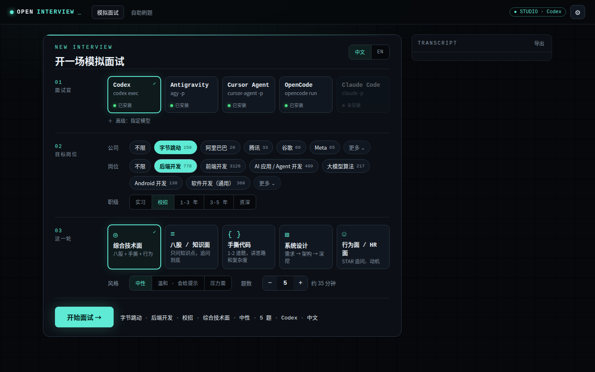
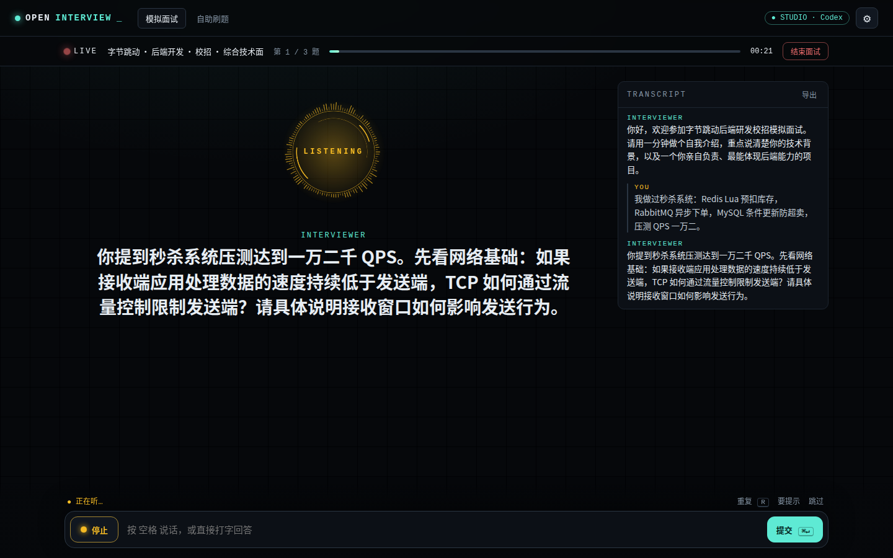
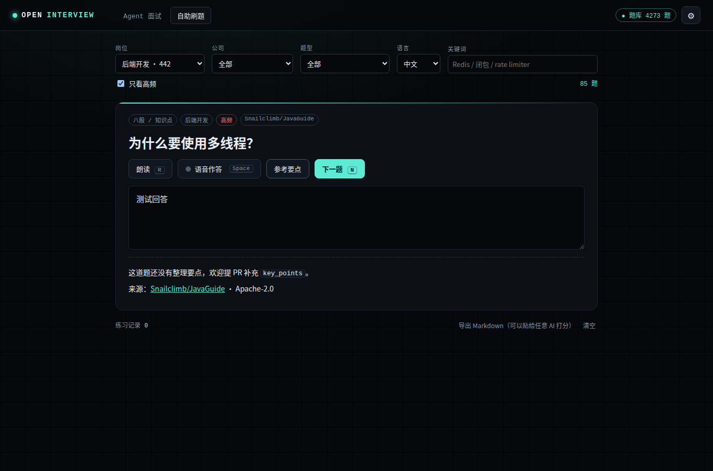

<div align="center">

# Open Interview

**开源面试题库 + 模拟面试官 + 免费语音面试**

从 4,000+ 道有出处的真题里按 **公司 / 岗位 / 轮次 / 知识点** 抽题，让你本机的 AI agent
（Claude Code、Codex、Antigravity、Cursor、OpenCode）当面试官：一题一题地问、追问，最后打分。
题目会被读出来，你直接开口回答。

**中文** · [English](README.en.md)

[网页面试](#方式一网页面试推荐) · [在 agent 里用](#方式二在-agent-里用) · [在线刷题](https://bigerbigernerd.github.io/open-interview/) · [题库](#题库) · [贡献题目和面经](CONTRIBUTING.md)

</div>

---

## 为什么做这个

- 面经散落在几十个仓库和帖子里，格式各不相同，agent 没法直接用。
- 现有的「模拟面试 prompt」大多让模型自己编题，题目不真实，也没有公司和轮次的信息。
- 这里把开源题目统一成一种 **带标签、带出处** 的格式，谁都可以提 PR 补充新题和新面经。
  面试官用的是你电脑上已经登录的 agent，不需要 API key，也不额外花钱。

## 三种用法

| | 适合谁 | 怎么开始 |
|---|---|---|
| **网页面试**（推荐） | 想打开网页就开始面试 | `python3 skills/mock-interviewer/scripts/studio.py` |
| **在 agent 里用** | 平时就在 Claude Code / Codex 里干活 | 装上 skill，说「语音面试我」 |
| **在线刷题** | 不想装任何东西，只想刷题 | 打开 [GitHub Pages](https://bigerbigernerd.github.io/open-interview/) |

## 方式一：网页面试（推荐）



```bash
git clone https://github.com/bigerbigernerd/open-interview
python3 open-interview/skills/mock-interviewer/scripts/studio.py
```

浏览器会自动打开。选一个面试官后端，再选公司、岗位、职级、轮次、语言和题数，点「开始面试」。
之后全程在网页里：题目读出来，你说话回答（也可以打字），可以要提示、跳过、随时结束，最后出报告。

页面会自动检测本机装了哪些 agent CLI，每一轮调用一次（无头模式、没有工具权限、在空目录里运行）：

| 面试官后端 | 命令 | 本机实测每轮耗时 |
|---|---|---|
| Codex | `codex exec`（只读沙箱，推理强度 low） | 约 10-15 秒 |
| Antigravity | `agy -p` | 约 15 秒 |
| Cursor Agent | `cursor-agent -p --mode ask` | 约 15-20 秒 |
| OpenCode | `opencode run --agent plan` | 约 10 秒 |
| Claude Code | `claude -p --tools ""` | 已适配，作者机器上暂未实测 |

用之前先在终端里把对应的 CLI 登录好。想换模型就在「模型」里填，比如 `gpt-5`、`sonnet`、`opencode/big-pickle`。
CLI 装在非标准位置时，可以用环境变量指定路径，例如 `OPEN_INTERVIEW_CODEX_BIN=/path/to/codex`。

检查哪些后端可用：

```bash
python3 skills/mock-interviewer/scripts/backends.py list
python3 skills/mock-interviewer/scripts/backends.py ping codex
```

## 方式二：在 agent 里用

**Claude Code**

```bash
/plugin marketplace add bigerbigernerd/open-interview
/plugin install open-interview@open-interview
```

**Codex / Cursor / Gemini CLI / OpenCode 等支持 Agent Skills 的工具**

```bash
npx skills add bigerbigernerd/open-interview
```

或者直接把 `skills/mock-interviewer/` 整个文件夹复制到你的 agent 的 skills 目录（例如 `~/.claude/skills/`）。
这个 skill 只依赖 Python 3 标准库。然后对 agent 说：

```text
模拟面试我：字节跳动 后端 校招一面，45 分钟
用语音面试我，Google SWE phone screen，英文
来 5 道大模型 RAG 方向的题，难度 3 以上，最后给我打分
```

要语音面试时，agent 会启动一个本地语音桥并给你一个链接：



```text
┌──────────────┐  voice.py ask "…"   ┌───────────────┐   long-poll   ┌────────────────────┐
│   你的 agent  │ ──────────────────▶ │ 本地语音桥     │ ◀───────────▶ │ 浏览器标签          │
│  （面试官大脑）│ ◀────────────────── │ 127.0.0.1:8765│               │ 朗读题目 + 听写回答  │
└──────────────┘     你的回答文本      └───────────────┘               └────────────────────┘
```

`voice.py ask` 最多等 50 秒，候选人还没说完就退出码 3，agent 再循环调用 `voice.py wait`，
所以不会撞上各家 agent 的命令超时。Codex 的默认沙箱会拦本地网络，第一次运行时允许它联网即可。

## 语音说明

- 朗读用浏览器自带的 `speechSynthesis`，免费。Edge 的 *Microsoft … Online (Natural)* 和 Chrome 的 *Google 普通话* 最自然，可以在页面右上角 ⚙ 里换声音和语速。
- 听写用 Web Speech API 的 `SpeechRecognition`，支持 Chrome、Edge、Safari。Firefox 不支持，可以直接打字。
- 隐私：服务只监听本机地址；但 Chrome / Edge 的语音识别会把音频发到 Google / Microsoft 的云端服务。介意的话就打字回答。
- 面试记录保存在 `~/.mock-interviewer/sessions/`，页面上也可以导出 Markdown。

## 自助刷题

同一个页面的「自助刷题」不需要 agent：按岗位、公司、题型、语言筛题，朗读题目，语音或打字作答，
看参考要点和出处。练习记录可以导出成 Markdown，贴给任何 AI 让它打分。



- 本地：`studio.py` 或 `voice.py start` 打开的页面里点「自助刷题」
- 线上：仓库开启 GitHub Pages（Source 选 GitHub Actions）后自动部署到 `https://bigerbigernerd.github.io/open-interview/`

## 题库

当前 **5,166** 道题（含 60 份面经里的 893 道），来自 18 个许可证允许再分发的开源项目，每道题都保留了原始链接。题目来源：

| 来源 | 题数 | 方向 | 许可证 |
|---|---:|---|---|
| [haizlin/fe-interview](https://github.com/haizlin/fe-interview) | 2,789 | 前端（中文，抽样权重调低） | MIT |
| [Snailclimb/JavaGuide](https://github.com/Snailclimb/JavaGuide) | 721 | Java 后端、计算机基础、AI 应用 | Apache-2.0 |
| [SuperGODOG/ai-agent-interview-240](https://github.com/SuperGODOG/ai-agent-interview-240) | 235 | AI Agent 开发、大模型、八股 | MIT |
| [h5bp/Front-end-Developer-Interview-Questions](https://github.com/h5bp/Front-end-Developer-Interview-Questions) | 145 | 前端（英文） | MIT |
| [kdn251/interviews](https://github.com/kdn251/interviews) | 129 | 算法题，按公司标注 | MIT |
| [yangshun/tech-interview-handbook](https://github.com/yangshun/tech-interview-handbook) | 117 | 行为面，按公司标注 | MIT |
| [MisterBooo/llm-interview-questions](https://github.com/MisterBooo/llm-interview-questions) | 100 | 大模型 / RAG / Agent | CC BY-SA 4.0 |
| [donnemartin/system-design-primer](https://github.com/donnemartin/system-design-primer) | 37 | 系统设计 | CC BY 4.0 |

每道题的标签：

| 字段 | 例子 | 说明 |
|---|---|---|
| `companies` | `bytedance`, `google` | 只有确实在这家公司被问过才标；别名可查（字节、tiktok 都能命中） |
| `roles` | `backend`, `frontend`, `ai-agent`, `llm-algorithm` | 有层级：查 `backend` 也会带上通用 `swe` 题 |
| `type` | `technical` `coding` `system-design` `behavioral` `project` `hr` | 八股 / 手撕 / 系统设计 / 行为面 / 项目 / HR |
| `topics` | `redis`, `rag`, `react` | 开放集合 |
| `levels` / `difficulty` / `hot` | `campus`, `3`, `true` | 校招社招、难度 1-5、高频 |

面经（一次真实面试的多轮记录）放在 `bank/experiences/`，agent 会优先按面经里的轮次结构来面。
目前有 **60** 份面经（893 道题，中文 44 份、英文 16 份），都是上游作者本人的面试记录，仓库用 MIT 许可证；公司、轮次、日期、结果只取作者写明的，没写就留空：

| 来源 | 面经 | 公司 / 方向 |
|---|---:|---|
| [HurleyWong/vuepress-interview-hurley](https://github.com/HurleyWong/vuepress-interview-hurley) | 13 | 字节、微信读书、阿里飞猪、微博、海康等，Android / Java 校招（上游未分轮次） |
| [CocaineCong/Golang-Interview](https://github.com/CocaineCong/Golang-Interview) | 11 | 字节、B站、百度、滴滴、米哈游、知乎、蔚来等，Go 后端 |
| [mayukhkchanda/react-interview-experience](https://github.com/mayukhkchanda/react-interview-experience) | 10 | Cvent、MakeMyTrip、Amdocs、Capgemini 等，React 前端社招（英文） |
| [imrohit1997/interview_experiences](https://github.com/imrohit1997/interview_experiences) | 6 | Deloitte、Infosys、LTIMindtree、iAcuity，Java 后端，2026（英文） |
| [Electronic-Waste/My-Job-Hunting](https://github.com/Electronic-Waste/My-Job-Hunting) | 4 | 字节基架、Intel、RisingWave、Databend，实习，带结果 |
| [Pypy233/Interview-Collection](https://github.com/Pypy233/Interview-Collection) | 4 | 头条基础架构、蚂蚁、大摩、SAP，实习 |
| [jx888-max/Interview-experience](https://github.com/jx888-max/Interview-experience) | 3 | 字节多模态、阿里大模型、快手算法，2025-10 日常实习 |
| [kevin-jk/InterviewExp](https://github.com/kevin-jk/InterviewExp) | 3 | 华为、招银网络科技、蚂蚁，Java 后端社招，都拿到 offer |
| [tumiMsaki/Interview-experience](https://github.com/tumiMsaki/Interview-experience) | 3 | 百度搜索、腾讯云、网易游戏，前端，带每轮时长 |
| [GGboya/interview](https://github.com/GGboya/interview) | 3 | 字节抖音支付 / 国际商业化、百度，后端，2024-2025 |

你自己的面经最有价值（模板：[`bank/experiences/_template.yml`](bank/experiences/_template.yml)）。

命令行查询：

```bash
cd skills/mock-interviewer
python3 scripts/bank.py stats
python3 scripts/bank.py sample --company 字节 --role backend --mix technical=3,coding=1,behavioral=1
python3 scripts/bank.py search --role ai-agent --topic rag --difficulty 3-5
python3 scripts/bank.py show <id> -v
```

## 仓库结构

```text
bank/
  tags.yml                  受控标签表：公司（含别名）、岗位（含层级）、题型、职级、常用 topic
  questions/                题目；imported/ 由脚本从上游生成，不要手改
  experiences/              面经，一次面试一个文件；imported/ 由脚本从上游生成
skills/mock-interviewer/    可单独安装的 skill
  SKILL.md                  面试官流程
  scripts/bank.py           查题（只用标准库）
  scripts/voice.py          agent 驱动模式的语音桥（只用标准库）
  scripts/studio.py         网页面试服务（只用标准库）
  scripts/backends.py       调用本机 agent CLI 的适配层
  ui/                       面试 + 自助刷题页面（无依赖、无构建）
  data/index.json           由 tools/build.py 生成的题库索引
tools/build.py              校验 bank/ 并生成索引
tools/import_upstream.py    重新导入上游题库
schema/                     给编辑器用的 JSON Schema（YAML 自动补全）
```

## 贡献

最有价值的贡献：**真实面经**、给已有题目补 `key_points`（好回答的要点）、纠正公司标签、新的开源题源。
详见 [CONTRIBUTING.md](CONTRIBUTING.md)。不会 git 也可以用 Issue 表单提交面经。

## Roadmap

- [ ] 第一批真实面经（字节 / 阿里 / 腾讯 / 美团 / 大模型岗）
- [ ] 高频题补全 `key_points`，让打分更稳定
- [ ] 完全离线的语音：本地 Whisper 听写、Kokoro / Piper 朗读
- [ ] 在线刷题页面支持填 OpenAI 兼容的 API key（DeepSeek、通义、Ollama），不装 agent 也能面试
- [ ] 跨来源去重、难度校准
- [ ] 更多岗位：数据、测试、运维、产品

## License

代码 MIT（[LICENSE](LICENSE)）；题库 CC BY-SA 4.0，第三方来源和许可证见 [LICENSE-DATA.md](LICENSE-DATA.md)。
